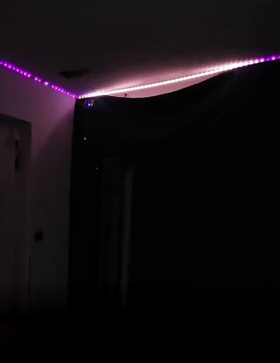
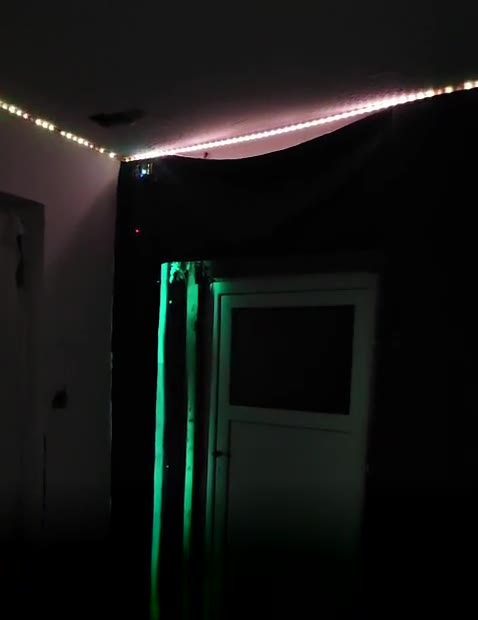

# Lumen Command

**WLAN-LED-Steuerung für ESP32 und WS2812B-Streifen – mit eigener Weboberfläche, 54 Effekten, Musik-Effekten über Mikrofon und Türlicht.**

🌐 **Projektseite mit Video und Installer:** https://sammy1987xxxx-dotcom.github.io/lumen-command/

<p>
  
  
</p>

> 🛠️ **Projekt im Aufbau:** Lumen Command läuft bei mir täglich. Die Bilder zeigen meinen echten, noch nicht
> fertig gebauten Aufbau.

> ### In short (English)
> Lumen Command is a firmware for the ESP32 that turns an addressable LED strip (WS2812B) into a Wi-Fi light
> with a clean, dark “Command Center” web interface. It ships with 54 effects, 26 of them music-reactive via a
> cheap microphone module, a per-LED painting grid, over-the-air updates and a door light that starts glowing
> from the door when a door sensor reports “open”.
> **The web interface and this guide are in German.** The setup is simple: flash, join the hotspot
> `LED-Controller-Setup` (password `1234567890`), enter your Wi-Fi, done – see [Schnellstart](#schnellstart).
> Questions in English are welcome in the Issues.

---

## Was kann Lumen Command?

- **Eigene Weboberfläche** im dunklen „Command Center“-Design – einfach im Browser von Handy oder PC bedienen, keine App nötig
- **54 Effekte**: ruhige Szenen (Nachtglut, Goldschweif, Polarlicht …), lebhafte Effekte und **26 Musik-Effekte**, die über ein Mikrofon im Takt reagieren
- **Feste Farbe, Helligkeit und „Alles AUS“** mit einem Klick
- **Einzel-LEDs malen** und „LED-Nr. zeigen“, um Positionen am Streifen zu finden
- **Türlicht**: Meldet eine Tür „offen“, wacht der Streifen von der Tür aus auf (bei „Alles AUS“ als warmes Nachtlicht, sonst als goldene Begrüßungswelle über dem laufenden Effekt). Türbereich, Helligkeiten und Ein/Aus stellst du auf der Webseite ein.
- **Einrichtung ohne Programmieren**: Ohne WLAN startet ein eigener Hotspot, dort trägst du dein WLAN ein
- **Updates über WLAN** (OTA) direkt auf der Webseite
- **Schonender Betrieb**: Die Ausgangshelligkeit ist begrenzt, alle Einstellungen bleiben nach einem Neustart erhalten

> 🎬 Ein kurzes Video (Farbwechsel, Tür geht auf, Türlicht springt an) gibt es auf der
> [Projektseite](https://sammy1987xxxx-dotcom.github.io/lumen-command/).

## Was du brauchst

| Teil | Hinweis |
|---|---|
| **ESP32-Board** | z. B. „ESP32 DevKit“ / „ESP32-WROOM-32“ / „ESP32S NodeMCU“ (klassischer ESP32, 4 MB Flash) |
| **LED-Streifen WS2812B** | 5 V, bis 600 LEDs. Andere Chips (SK6812, WS2811) gehen nach Anpassung im Code |
| **Netzteil 5 V** | Faustregel: etwa 0,05 A pro LED bei voller weißer Helligkeit (Lumen Command begrenzt auf ca. 82 %). Beispiel: 300 LEDs → 5 V / 15 A |
| **Widerstand 330 Ω** | in der Datenleitung, nahe am Streifen (empfohlen) |
| **Kondensator 1000 µF** | zwischen 5 V und GND am Streifen-Anfang (empfohlen) |
| **Mikrofonmodul KY-037** *(optional)* | Getestet mit dem KY-037 (Analogausgang AO und Digitalausgang DO). Ohne Mikrofon laufen alle Nicht-Musik-Effekte |
| **Pegelwandler** *(optional)* | z. B. 74AHCT125, falls der Streifen bei 3,3-V-Daten flackert |

## Anschluss

```
                ┌────────────────────┐
  Netzteil 5V ──┼──────────────┬─────┼──► LED-Streifen  +5V
  Netzteil GND ─┼───────┬──────┼─────┼──► LED-Streifen  GND
                │       │   [1000µF] │
                │       │      │     │
                │   ESP32 GND ─┘     │
                │   ESP32 GPIO 2 ──[330 Ω]──► LED-Streifen DIN
                └────────────────────┘

  KY-037:         VCC → 3,3 V   GND → GND   AO → GPIO 35   DO → GPIO 16
```

- **GND von ESP32, Netzteil und Streifen müssen verbunden sein.**
- Den ESP32 kannst du über USB versorgen oder über seinen 5V/VIN-Pin aus demselben Netzteil – **nicht beides gleichzeitig**.
- Lange Streifen (ab ca. 150–200 LEDs) zusätzlich in der Mitte und am Ende mit 5 V und GND einspeisen, sonst werden sie zum Ende hin rot/dunkel.
- Andere Pins? Siehe [Eigene Anpassungen](#eigene-anpassungen).

## Schnellstart

### 1. Firmware aufspielen

**Variante A – im Browser (am einfachsten):**

> ⚠️ **Noch nicht getestet:** Der Browser-Installer ist neu und von mir noch nicht mit einem echten ESP32
> ausprobiert. Testen ist auf eigene Gefahr gern erlaubt – Rückmeldung bitte als Issue. Bewährt ist bis dahin
> Variante B (Arduino IDE).

Auf der **[Projektseite](https://sammy1987xxxx-dotcom.github.io/lumen-command/)** den ESP32 per USB anstecken, in Chrome,
Edge oder Opera am Computer auf **„Lumen Command installieren“** klicken, Port wählen – fertig.
Für spätere Updates die Datei `docs/firmware/lumen-command-update.bin` über die Weboberfläche hochladen.

**Variante B – mit der Arduino IDE:**

1. [Arduino IDE](https://www.arduino.cc/en/software) installieren.
2. Unter *Einstellungen → Zusätzliche Boardverwalter-URLs* eintragen:
   `https://espressif.github.io/arduino-esp32/package_esp32_index.json`
3. *Boardverwalter*: **esp32 von Espressif** installieren (getestet mit **3.3.1**).
4. *Bibliotheksverwalter*: **FastLED** (getestet 3.10.5) und **ArduinoJson** (getestet 7.4.3) installieren.
5. Den Ordner `firmware/LumenCommand` öffnen (`LumenCommand.ino`).
6. Einstellungen unter *Werkzeuge*:
   - Board: **ESP32 Dev Module**
   - Partition Scheme: **Minimal SPIFFS (1.9MB APP with OTA/190KB SPIFFS)** – wichtig, sonst passt die Firmware nicht bzw. Updates über WLAN gehen nicht
7. Port wählen und **Hochladen**.

### 2. Einrichten

1. Nach dem Start (ohne gespeichertes WLAN) blinkt der Streifen dreimal rot und öffnet den Hotspot
   **`LED-Controller-Setup`**, Passwort **`1234567890`**.
2. Mit Handy oder PC verbinden und **http://192.168.4.1** öffnen.
3. Anmelden mit Benutzer **`admin`**, Passwort **`1234567890`**.
4. Unter **WLAN Konfiguration** dein WLAN eintragen → *Speichern & Neustart*.
5. Der ESP32 verbindet sich mit deinem WLAN. Die neue Adresse findest du in deinem Router (Gerät „esp32-…“)
   oder im seriellen Monitor (115200 Baud).
6. **Wichtig:** Unter **Zugangsdaten ändern** ein eigenes Passwort setzen. Der Standard `admin` / `1234567890`
   ist öffentlich bekannt.
7. Unter **Globale Steuerung** die **Anzahl LEDs** deines Streifens einstellen.

Fertig – viel Spaß! 🎉

## Bedienung

- **Effekte**: Klick auf einen Effekt-Knopf. Effekte mit orangem **„A“** reagieren auf Musik (Mikrofon).
- **Feste Farbe / Alles AUS**: Farbwähler oder roter Knopf.
- **Globale Steuerung**: Helligkeit, Anzahl LEDs, Türlicht-Einstellungen, Firmware-Update.
- **Effekt-Anpassung**: Geschwindigkeit, Schweif, Farben … je Effekt; *Mikrofon* → Empfindlichkeit 1–10.
- **Einzel-LED-Steuerung**: LEDs einzeln anmalen, „LED-Nr. zeigen“ zum Suchen von Positionen.
- **Update**: *Firmware Update (OTA)* → neue `.bin`-Datei auswählen. Einstellungen und WLAN bleiben erhalten.

Eine Beschreibung aller Effekte steht in [docs/EFFEKTE.md](docs/EFFEKTE.md).

## Türlicht

Lumen Command lauscht im Heimnetz auf **UDP-Port 4210**. Eine Meldung im JSON-Format löst das Türlicht aus:

```json
{"type":"door_light","state":"open"}
{"type":"door_light","state":"closed"}
```

- **„Alles AUS“ aktiv:** Der Streifen fährt von der Tür aus flackernd hoch und bleibt als warmes Nachtlicht an,
  bis „closed“ kommt (spätestens nach 30 Minuten).
- **Effekt läuft:** Eine goldene Begrüßungswelle läuft von der Tür über den Streifen, der Türbereich glüht, solange
  die Tür offen ist.
- Einstellbar unter *Globale Steuerung*: **Türlicht** an/aus, **Tür über LED (von – bis)**,
  **Türlicht bei „Alles AUS“** (Helligkeit des Nachtlichts) und **Türzeichen bei laufendem Effekt** (Helligkeit
  der Welle, unabhängig vom Hauptregler).

Die passende Türsteuerung (ESP32-Türantrieb mit Schalter „Türlicht“) wird später ebenfalls veröffentlicht.
Bis dahin kannst du die Meldung von jedem Gerät im Netz schicken, z. B. von einem Tür-/Fenstersensor über
Home Assistant, Node-RED oder zum Testen mit Python:

```python
import socket
s = socket.socket(socket.AF_INET, socket.SOCK_DGRAM)
s.sendto(b'{"type":"door_light","state":"open"}', ("IP-DEINES-ESP32", 4210))
```

## Eigene Anpassungen

Alles, was beim Bauen feststehen muss, steht oben in
[`firmware/LumenCommand/Globals.h`](firmware/LumenCommand/Globals.h) im Block **„HIER ANPASSEN“**:

| Einstellung | Standard | Bedeutung |
|---|---|---|
| `LED_PIN` | `2` | GPIO für die Datenleitung (DIN) |
| `LED_TYPE` | `WS2812B` | LED-Chip (FastLED-Name) |
| `COLOR_ORDER` | `GRB` | Bei vertauschten Farben z. B. `RGB` probieren |
| `MAX_LEDS` | `600` | Obergrenze; die echte Anzahl stellst du auf der Webseite ein |
| `MIC_PIN_AO` | `35` | Analogausgang des Mikrofons (nur ADC1-Pins 32–39 funktionieren mit WLAN) |
| `MIC_PIN_DO` | `16` | Digitalausgang des Mikrofons |

Alles andere – WLAN, Anzahl LEDs, Türbereich, Helligkeiten, Effekt-Einstellungen – stellst du auf der Webseite
ein. Es wird im ESP32 gespeichert und bleibt bei Updates erhalten.

## Sicherheit

Die Weboberfläche ist mit Benutzer und Passwort geschützt, läuft aber über unverschlüsseltes HTTP, und die
Türlicht-Meldungen (UDP) sind ohne Anmeldung. Lumen Command ist für das **eigene Heimnetz** gedacht –
nicht direkt ins Internet freigeben.

## Mitmachen

Lumen Command ist ein Hobbyprojekt. Fehlerberichte, Ideen und Verbesserungen sind willkommen – bitte vorher
[CONTRIBUTING.md](CONTRIBUTING.md) lesen.

## Lizenz und Urheber

© Thomas Brants (Sammy). Lumen Command steht unter der
**[GNU General Public License v3](LICENSE)** mit einem **[Zusatz nach Abschnitt 7(b)](LIZENZ-ZUSATZ.md)**:

- Du darfst Lumen Command frei nutzen, verändern und weitergeben – auch verändert.
- Veränderte Versionen müssen ebenfalls unter der GPLv3 mit Quellcode weitergegeben werden.
- **Der Urheberhinweis „Thomas Brants (Sammy)“ muss erhalten bleiben** – in den Quelldateien und im Bereich
  „Entwicklung & Mitwirkung“ unten auf der Weboberfläche.

Entwickelt von Thomas Brants (Sammy) mit KI-Unterstützung durch ChatGPT / Codex (OpenAI), Jules (Google) und
Claude Code (Anthropic); Anregung zum ChatGPT-Effekt von Fiemin.
Verwendete Bibliotheken: [FastLED](https://github.com/FastLED/FastLED) (MIT),
[ArduinoJson](https://arduinojson.org) (MIT), [Arduino-ESP32](https://github.com/espressif/arduino-esp32) (LGPL 2.1).
